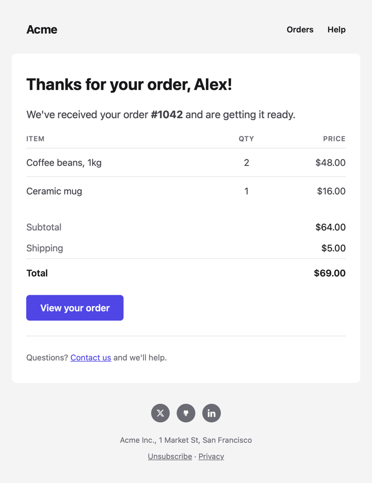

# Core components

`MjmlEEx.CoreComponents` is a set of ready-made components for the parts most emails share: the document, a header,
cards, headings, text, buttons, tables, callouts, a footer and more. They're styled with a theme, so emails built from
them look clean and consistent without writing any styles.



## Getting started

Import the components in your email modules:

```elixir
defmodule MyApp.Emails.Receipt do
  use MjmlEEx
  import MjmlEEx.CoreComponents

  def render(assigns) do
    ~MJML"""
    <.email title="Your receipt from Acme" preview={"Thanks for your order, #{@name}!"}>
      <.header title="Acme" href="https://acme.com">
        <:link href="https://acme.com/orders">Orders</:link>
        <:link href="https://acme.com/help">Help</:link>
      </.header>
      <.card>
        <.heading>Thanks for your order, {@name}!</.heading>
        <.text variant="lead">We've received your order <strong>#{@number}</strong> and are getting it ready.</.text>
        <.table rows={@items}>
          <:col :let={item} label="Item">{item.name}</:col>
          <:col :let={item} label="Qty" align="center" width="15%">{item.qty}</:col>
          <:col :let={item} label="Price" align="right" width="25%">{item.price}</:col>
        </.table>
        <.list>
          <:item title="Subtotal">{@subtotal}</:item>
          <:item title="Shipping">{@shipping}</:item>
          <:item title="Total" strong>{@total}</:item>
        </.list>
        <.button href={@order_url}>View your order</.button>
        <.divider />
        <.text variant="small">Questions? <.link href="mailto:help@acme.com">Contact us</.link> and we'll help.</.text>
      </.card>
      <.footer>
        Acme Inc., 1 Market St, San Francisco
        <:link href={@unsubscribe_url}>Unsubscribe</:link>
        <:link href="https://acme.com/privacy">Privacy</:link>
        <:social name="x" href="https://x.com/acme" />
        <:social name="github" href="https://github.com/acme" />
        <:social name="linkedin" href="https://linkedin.com/company/acme" />
      </.footer>
    </.email>
    """
  end
end
```

That's the whole email in the image above. The MJML it renders is almost four times as long. For more complete
emails built with the components, see the [prebuilt templates](prebuilt_templates.md).

If a module defines a function with the same name as a core component, leave the component out of the import:
`import MjmlEEx.CoreComponents, except: [button: 1]`.

## The components

The components fit together like MJML's own tags. `email/1` is the document, sections go in its body, and content goes
in cards:

| Component | What it is | It renders | It goes in |
| --------- | ---------- | ---------- | ---------- |
| `email/1` | A whole email, with the theme in its head | `mjml` | |
| `theme/1` | The theme's defaults for the document | `mj-attributes`, `mj-style` | `mj-head` |
| `header/1` | A logo or title, and optional links | `mj-section` | `email/1`, `mj-body`, `mj-wrapper` |
| `hero/1` | A banner in a bold color or with a background image | `mj-section` | `email/1`, `mj-body`, `mj-wrapper` |
| `card/1` | A rounded box for content | `mj-section` | `email/1`, `mj-body`, `mj-wrapper` |
| `footer/1` | Small print, links and social icons | `mj-section` | `email/1`, `mj-body`, `mj-wrapper` |
| `heading/1` | A heading, level 1 to 3 | `mj-text` | `card/1`, `hero/1`, `mj-column` |
| `text/1` | A paragraph: body, lead, muted, small or an eyebrow label | `mj-text` | `card/1`, `hero/1`, `mj-column` |
| `button/1` | A button: primary, secondary, outline or danger | `mj-button` | `card/1`, `hero/1`, `mj-column` |
| `badge/1` | A short label in a pill, such as "New" | `mj-text` | `card/1`, `hero/1`, `mj-column` |
| `divider/1` | A horizontal rule | `mj-divider` | `card/1`, `hero/1`, `mj-column` |
| `spacer/1` | Empty space | `mj-spacer` | `card/1`, `hero/1`, `mj-column` |
| `callout/1` | A note: info, success, warning, danger or neutral | `mj-table` | `card/1`, `hero/1`, `mj-column` |
| `code/1` | A code to copy, such as a sign-in code | `mj-table` | `card/1`, `hero/1`, `mj-column` |
| `blockquote/1` | A quote, with who said it | `mj-table` | `card/1`, `hero/1`, `mj-column` |
| `table/1` | A table of data, with a column per slot | `mj-table` | `card/1`, `hero/1`, `mj-column` |
| `list/1` | Titles and values, such as an order's totals | `mj-table` | `card/1`, `hero/1`, `mj-column` |
| `checklist/1` | Items with check marks, such as a plan's features | `mj-table` | `card/1`, `hero/1`, `mj-column` |
| `steps/1` | Numbered steps, such as how to get started | `mj-table` | `card/1`, `hero/1`, `mj-column` |
| `accordion/1` | Titles that expand to show text | `mj-accordion` | `card/1`, `hero/1`, `mj-column` |
| `navbar/1` | A row of links | `mj-navbar` | `card/1`, `hero/1`, `mj-column` |
| `social/1` | Social icons | `mj-social` | `card/1`, `hero/1`, `mj-column` |
| `link/1` | A link in the theme's color | `a` | `text/1`, `mj-text`, table cells |
| `avatar/1` | A person's photo, or their initials | `img`, `span` | `text/1`, `mj-text`, table cells |

See `MjmlEEx.CoreComponents` for each component's attributes and slots. Like any component, their calls are checked
when your templates compile, so a misspelled attribute or a `variant` that doesn't exist fails the build.

Content in a `hero/1` with the `"primary"` or `"dark"` variant is styled for the hero's color: the components inside
it get light text, light buttons and tinted boxes, so the same components work in heroes and cards:

```heex
<.hero variant="dark" background_image="https://acme.com/images/sale.jpg">
  <.badge solid align="center">Flash sale</.badge>
  <.heading align="center" font-size="52px" line-height="56px">40% off everything</.heading>
  <.button href={@shop_url} align="center">Shop the sale</.button>
</.hero>
```

The components work anywhere their MJML tags do, so you can mix them with MJML. A card's content can include
`mj-image` or `mj-text`, and an email can have an `mj-section` with several columns between two cards.

## Layouts

Most emails from an app share a header and footer. Put them in a [layout](layouts.md), around `{@inner_content}`:

```elixir
defmodule MyApp.Emails.Layout do
  use MjmlEEx
  import MjmlEEx.CoreComponents

  def render(assigns) do
    ~MJML"""
    <.email title={@subject} preview={assigns[:preview]}>
      <.header logo="https://acme.com/logo.png" logo_alt="Acme" href="https://acme.com" />
      {@inner_content}
      <.footer>
        Acme Inc., 1 Market St, San Francisco
        <:link href={@unsubscribe_url}>Unsubscribe</:link>
      </.footer>
    </.email>
    """
  end
end

defmodule MyApp.Emails.PasswordReset do
  use MjmlEEx, layout: MyApp.Emails.Layout
  import MjmlEEx.CoreComponents

  def render(assigns) do
    ~MJML"""
    <.card>
      <.heading>Reset your password</.heading>
      <.text>Someone asked to reset the password for your Acme account.</.text>
      <.button href={@reset_url}>Reset password</.button>
      <.callout title="This link expires in 24 hours">
        If you didn't ask for this, you can ignore this email.
      </.callout>
    </.card>
    """
  end
end
```

If you write the `mjml` document yourself instead of using `email/1`, put `theme/1` in its `mj-head`. It sets the
theme's font, text color and link color for the document, so MJML tags such as `mj-text` match the components. The
components themselves are styled with or without it.

## Theming

The default theme is a neutral gray palette with an indigo accent. Change it for the whole app in your config:

```elixir
config :mjml_eex, :theme,
  primary: "#E11D48",
  font_family: "Inter, Helvetica, Arial, sans-serif",
  radius: "12px"
```

The tokens are colors (`primary`, `background`, `surface`, `text`, `heading`, `muted`, `border`, and the callout
colors), fonts and sizes. See `MjmlEEx.Theme` for all of them and their defaults. Values are MJML attribute values,
so sizes need their unit, and they're checked against MJML's types: an invalid color raises an `ArgumentError` that
names the token. Colors are hex colors (`"#E11D48"`), `rgb()` or `rgba()` colors, or color names.

To use a web font, load it with an `mj-font` in the `:head` slot of `email/1`, and put it first in `font_family`:

```heex
<.email title="Welcome">
  <:head>
    <mj-font name="Inter" href="https://fonts.googleapis.com/css2?family=Inter:wght@400;600;700" />
  </:head>
  ...
</.email>
```

Email clients that can't load web fonts use the next font in the list.

### A theme per email

Apps that send emails for several brands can set the theme for the process that renders an email, with
`MjmlEEx.Theme.put/1`, before calling `to_html/1`. Its tokens apply on top of the configured theme:

```elixir
MjmlEEx.Theme.put(primary: account.brand_color)
MyApp.Emails.Welcome.to_html(assigns)
```

Like `Gettext.put_locale/1`, it only affects the process that calls it, and lasts until it's changed or cleared with
`MjmlEEx.Theme.put(nil)`.

`put/1` raises for an invalid value, so check values that your users set with `MjmlEEx.Theme.validate/1` when
they're saved, rather than finding out when an email is sent:

```elixir
def changeset(account, attrs) do
  account
  |> cast(attrs, [:brand_color])
  |> validate_change(:brand_color, fn :brand_color, color ->
    case MjmlEEx.Theme.validate(primary: color) do
      {:ok, _theme} -> []
      {:error, message} -> [brand_color: message]
    end
  end)
end
```

## Changing one component

Each component passes the attributes it doesn't declare to the MJML tag it renders, and they take precedence over the
theme's styles. A `button/1` renders an `mj-button`, so it takes any `mj-button` attribute:

```heex
<.button href={@url} align="center" font-size="18px" inner-padding="16px 32px">Get started</.button>
<.card background-color="#FFFBEB" padding="32px 0">...</.card>
<.text variant="small" align="center">...</.text>
```

These attributes are checked against the MJML tag when the template compiles, like any `:global` attribute (see
[Components](components.md#global-attributes)).

`mj-class` and `css-class` are passed through too. An `mj-class` can't override a style the component sets, though,
because MJML gives an element's own attributes precedence over its classes.

## Your own components

Build your own components from the core ones, for the patterns your emails repeat:

```elixir
defmodule MyApp.Emails.Components do
  use MjmlEEx.Component
  import MjmlEEx.CoreComponents

  attr :href, :string, required: true
  slot :inner_block, required: true

  def cta(assigns) do
    ~MJML"""
    <.button href={@href} align="center" full_width>{render_slot(@inner_block)}</.button>
    <.text variant="small" align="center">
      Or copy this link into your browser: <.link href={@href}>{@href}</.link>
    </.text>
    """
  end
end
```

## Email client support

The components follow MJML, so they work in the same email clients. A few things depend on the client:

- Rounded corners on cards, heroes, buttons, badges, callouts and codes, and round avatars, are square in Outlook on
  Windows.
- A hero's background image shows in most clients, including Outlook. Where it doesn't, the hero's color does.
- Accordions only open and close in clients that support it, such as Apple Mail. Other clients show every item's
  text.
- The theme's link color for plain `a` tags is set with a `<style>` block, which a few clients remove. Links made with
  `link/1` have their color inline, so they're the same everywhere.
- Social icons are images hosted by Mailjet, like MJML's. To host them yourself, set the `:social_icon_path` compiler
  option (see [Configuration](configuration.md)), or give each icon a `src`.
