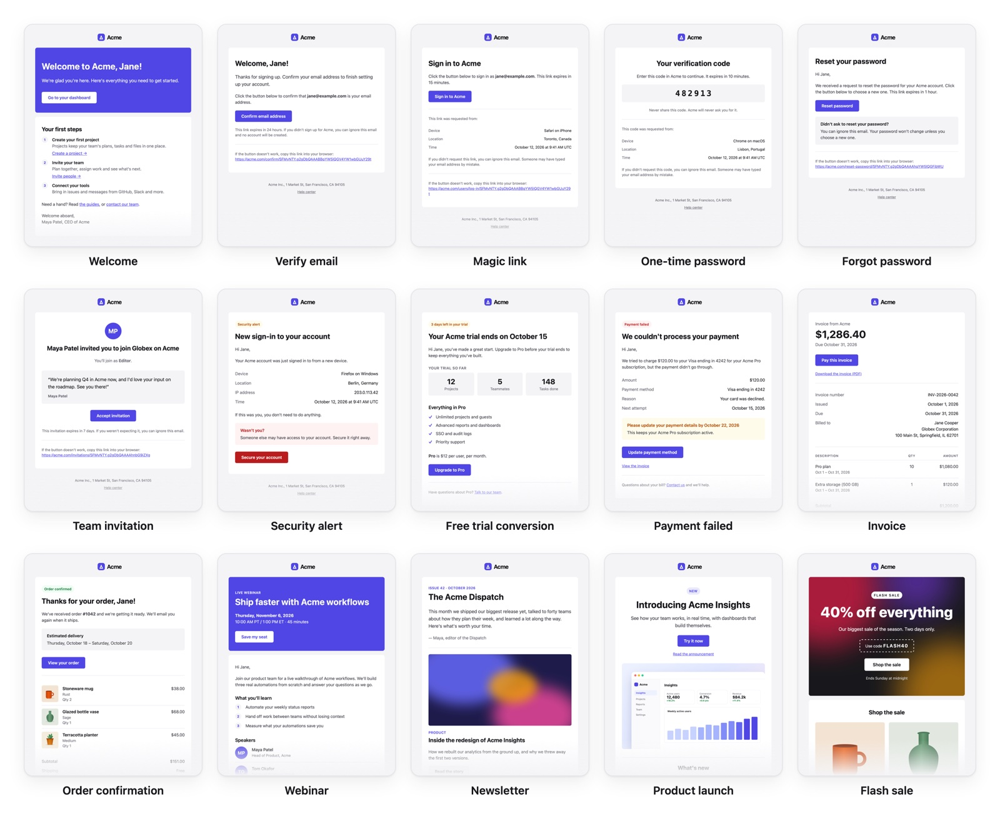

# Prebuilt templates

MJML EEx comes with templates for common emails, built with the [core components](core_components.md) and styled
with your theme. Use one as it is, with your own content, or copy it into your app as a starting point.



## The templates

### Accounts

| Template | For |
| -------- | --- |
| `MjmlEEx.Templates.Welcome` | Greeting a new user, with their first steps ([screenshot](images/templates/welcome.jpg)) |
| `MjmlEEx.Templates.VerifyEmail` | Confirming a new account's email address ([screenshot](images/templates/verify_email.jpg)) |
| `MjmlEEx.Templates.MagicLink` | A link that signs the user in, for passwordless sign-in ([screenshot](images/templates/magic_link.jpg)) |
| `MjmlEEx.Templates.OneTimePassword` | A code to sign in or confirm an action with ([screenshot](images/templates/one_time_password.jpg)) |
| `MjmlEEx.Templates.ForgotPassword` | A link to reset a password ([screenshot](images/templates/forgot_password.jpg)) |
| `MjmlEEx.Templates.TeamInvitation` | An invitation to join a team or workspace ([screenshot](images/templates/team_invitation.jpg)) |
| `MjmlEEx.Templates.SecurityAlert` | A new sign-in, or a changed password, email address or two-factor setting ([screenshot](images/templates/security_alert.jpg)) |

### Billing and orders

| Template | For |
| -------- | --- |
| `MjmlEEx.Templates.TrialConversion` | Asking a user to upgrade as their free trial ends ([screenshot](images/templates/trial_conversion.jpg)) |
| `MjmlEEx.Templates.PaymentFailed` | A subscription payment that didn't go through ([screenshot](images/templates/payment_failed.jpg)) |
| `MjmlEEx.Templates.Invoice` | An invoice, with its line items and a button to pay it ([screenshot](images/templates/invoice.jpg)) |
| `MjmlEEx.Templates.OrderConfirmation` | An online store's order, with its items and where it's going ([screenshot](images/templates/order_confirmation.jpg)) |

### Marketing

| Template | For |
| -------- | --- |
| `MjmlEEx.Templates.Webinar` | An invitation to a webinar or another live event ([screenshot](images/templates/webinar.jpg)) |
| `MjmlEEx.Templates.Newsletter` | A newsletter, with a featured story and more stories ([screenshot](images/templates/newsletter.jpg)) |
| `MjmlEEx.Templates.ProductLaunch` | Announcing a product or a feature ([screenshot](images/templates/product_launch.jpg)) |
| `MjmlEEx.Templates.FlashSale` | A sale, with a promo code and products ([screenshot](images/templates/flash_sale.jpg)) |

Each template's documentation lists its assigns, and has an example and a screenshot.

## Using a template

A template is a module with `to_html/1` and `to_text/1`, like your own email modules. Pass it your content as
assigns:

```elixir
assigns = [
  product_name: "Acme",
  logo: "https://acme.com/images/logo.png",
  name: user.name,
  reset_url: url(~p"/users/reset-password/#{token}"),
  address: "Acme Inc., 1 Market St, San Francisco"
]
```

and send the HTML and the plain-text version with your mailer, such as [Swoosh](https://hexdocs.pm/swoosh):

```elixir
new()
|> to(user.email)
|> from({"Acme", "hello@acme.com"})
|> subject("Reset your Acme password")
|> html_body(MjmlEEx.Templates.ForgotPassword.to_html(assigns))
|> text_body(MjmlEEx.Templates.ForgotPassword.to_text(assigns))
|> MyApp.Mailer.deliver()
```

The assigns are checked when the email renders: a missing required assign, or one of the wrong type, raises an
`ArgumentError` that names it. Values are HTML-escaped, so user input such as names is safe to pass.

Templates show text, dates and amounts as they're given, so format them first, in the user's language and currency.
Their own text is in English. To translate it, copy the template.

Images, such as logos, product photos and the flash sale's background, are URLs of images you host. Use absolute URLs,
since the email is read far from your app.

### Theming

The templates use the [theme](core_components.md#theming), so they match your other emails: set your colors and fonts
in your config, or set a theme for one email with `MjmlEEx.Theme.put/1`:

```elixir
MjmlEEx.Theme.put(primary: account.brand_color)
MjmlEEx.Templates.Invoice.to_html(assigns)
```

### Marketing emails

In many countries, marketing emails need a way to unsubscribe and the sender's postal address. The webinar,
newsletter, product launch and flash sale templates require an `:unsubscribe_url` and an `:address`. Both are shown
in the footer.

### Preview text and language

Every template takes a `:preview`, the text that inboxes show after the subject, and has a default for it from your
content. Templates declare their language as English (`lang="en"`), the language of their text, for screen readers.
If you pass content in another language, also pass `:lang` (and `:dir`, such as `"rtl"` for Arabic or Hebrew).

## Copying a template

To change a template's text or layout, copy it into your app. Each template is a single file, built from the core
components and MJML, so the copy works on its own:

1. Copy the template's file from `deps/mjml_eex/lib/mjml_eex/templates/` (or open its source from the `</>` link in
   its documentation) to your app, such as `lib/my_app/emails/forgot_password.ex`.
2. Rename the module, such as to `MyApp.Emails.ForgotPassword`, and replace its `@moduledoc`.
3. Change it however you need. It's your email now, and its template is checked when your app compiles, like your
   other emails.

To add your own header and footer, put them in a [layout](layouts.md) instead of each email: remove `email/1`, the
header and the footer from the copy, and use the layout from the
[Core components guide](core_components.md#layouts).

## Email client support

The templates follow MJML, so they work in the same email clients, and the
[core components' notes](core_components.md#email-client-support) apply. Also:

- The flash sale's hero has its background image in most clients. Clients that don't show background images show the
  theme's `heading` color instead, so the text stays readable.
- People without a photo, such as the webinar's speakers and the team invitation's sender, are shown with their
  initials in a circle, which is a square in Outlook on Windows.
